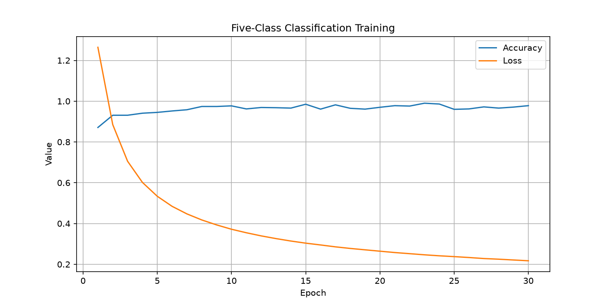

# 第二周作业：基于 PyTorch 的五分类任务

## 1. 任务描述

设计并训练一个五分类神经网络。

输入为一个五维向量，按照最大元素所在的位置划分类别。例如：

- 输入 `[0.9, 0.2, 0.3, 0.4, 0.1]`，标签为 0。
- 输入 `[0.1, 0.8, 0.2, 0.3, 0.4]`，标签为 1。

类别标签为 0～4，对应最大值位于第 1～5 维。

## 2. 数据集生成

使用 NumPy 随机生成五维向量，元素取值范围为 `[0,1)`。

使用 `np.argmax()` 获取最大元素的索引，并作为真实类别标签。

输入数据使用 `FloatTensor`，标签使用 `LongTensor`。

## 3. 模型设计

使用 PyTorch 构建一个单层全连接神经网络。

- 输入维度：5
- 输出维度：5
- 网络结构：`nn.Linear(5, 5)`
- 损失函数：`nn.CrossEntropyLoss()`
- 优化器：Adam

模型输出五个类别的原始得分（Logits），使用 `argmax` 得到预测类别。

## 4. 训练参数

| 参数 | 数值 |
|---|---|
| Epoch | 30 |
| Batch Size | 20 |
| 训练样本数量 | 5000 |
| Learning Rate | 0.01 |
| 优化器 | Adam |

## 5. 实验结果

训练过程中，Loss 总体持续下降，分类准确率逐渐提高。

| Epoch | 平均 Loss | 测试准确率 |
|---|---|---|
| 1 | 1.264340 | 87.1% |
| 2 | 0.885100 | 93.1% |
| 3 | 0.705351 | 93.1% |
| 27 | 0.228222 | 97.2% |
| 28 | 0.225008 | 96.6% |
| 29 | 0.221107 | 97.1% |
| 30 | 0.217249 | 97.8% |

第 30 轮使用新生成的 1000 个随机样本评估，正确预测 978 个，准确率为 97.8%。

### 训练曲线



## 6. 结果分析

实验结果表明，简单的全连接神经网络能够学习五维向量最大值位置的分类规律。

部分预测错误出现在最大值与第二大值十分接近的样本中。模型整体取得了较高的分类准确率，但尚未达到完全准确。

## 7. 运行方式

运行训练和预测程序：

```bash
python classification.py
```

## 8. 文件说明

- `classification.py`：模型、数据生成、训练、评估及预测代码。
- `model.bin`：训练得到的模型参数。
- `training_curve.png`：训练 Loss 与 Accuracy 曲线。
- `README.md`：作业说明及实验结果。
